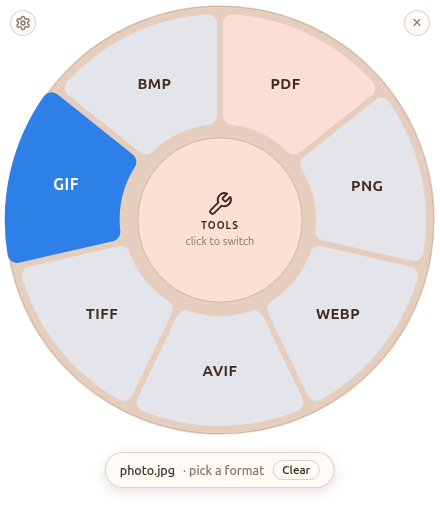
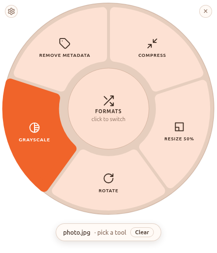
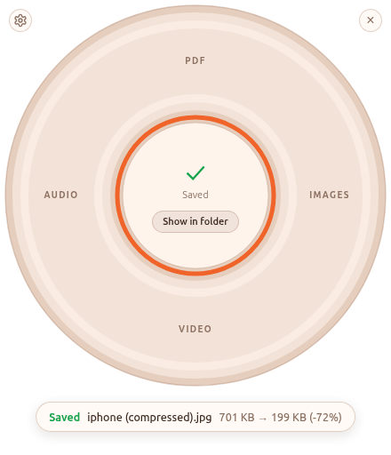
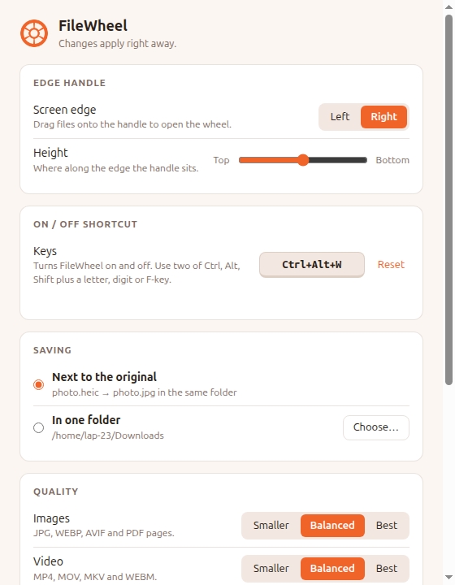

<h1 align="center">FileWheel</h1>

<b>Drag a file to the edge of your screen, drop it on a format, done.</b> 
Converts documents, images, PDFs, video and audio — on your own computer, nothing uploaded.

<a href="https://github.com/Aadiv2104/filewheel-releases/releases"><b>⬇ Download for Windows, macOS and Linux</b></a>

&nbsp;&nbsp;

## How it works

1. A thin **orange handle** sits on the edge of your screen.
2. **Drag a file onto it** — a wheel opens with only the formats that make sense for that file.
3. **Let go on a format.** The converted file appears next to the original.

Rest on the centre to switch to **Tools** (compress, resize, rotate, merge PDFs…).
**Ctrl + Alt + W** turns FileWheel on and off (Control + Option + W on a Mac).

## What it converts

| You have | You can get |
|---|---|
| Word, Excel, PowerPoint (doc, docx, xls, xlsx, ppt, pptx, odt, ods, odp, rtf) | PDF |
| PDF | Word (DOCX), text, PNG/JPG images (one per page) |
| Images: JPG, PNG, WEBP, GIF, TIFF, AVIF, SVG, BMP, iPhone HEIC | JPG, PNG, WEBP, AVIF, TIFF, GIF, BMP, PDF — or several images into one PDF |
| Video: MP4, MOV, MKV, AVI, WEBM, WMV and more | MP4, WEBM, MOV, MKV, GIF, MP3, WAV |
| Audio: MP3, WAV, AAC, M4A, FLAC, OGG, OPUS, WMA | MP3, WAV, M4A, AAC, FLAC, OGG, OPUS |

**Tools:** compress, resize, rotate and grayscale images, remove photo metadata · merge, split and rotate
PDFs · compress, mute and rotate videos · normalize loudness and trim silence in audio.

## Download and install

Get the files from the **[Releases page](https://github.com/Aadiv2104/filewheel-releases/releases)** (under *Assets*).

| System | File | How to install |
|---|---|---|
| **Windows** 10 / 11 | `FileWheel-Setup-….exe` | Run it. Windows may show *"Windows protected your PC"* because the app isn't code-signed yet — click **More info → Run anyway**. |
| **Ubuntu / Debian** | `filewheel_…_amd64.deb` | `sudo apt install ./filewheel_…_amd64.deb`, then open FileWheel from your apps. |
| **Other Linux** | `FileWheel-…-linux-x86_64.AppImage` | Make it executable and run it. Ubuntu 22.04+ needs `sudo apt install libfuse2t64` for AppImages. |
| **macOS** (Apple Silicon) | `FileWheel-…-mac-arm64.dmg` | Drag FileWheel to Applications. The first time, macOS blocks it (not notarized): **System Settings → Privacy & Security → Open Anyway**. |

**Word, Excel and PowerPoint files** are converted with Microsoft Office if you have it (Windows), or with the
free [LibreOffice](https://www.libreoffice.org/download/). Everything else needs no extra software.

## Good to know

- **Private:** everything happens on your computer; files are never uploaded.
- **Safe:** originals are never changed — results are new files (`report (1).pdf` if `report.pdf` exists).
- **Settings** (⚙ on the wheel, or the tray / top-bar icon): handle position, shortcut keys, where files
  are saved, image and video quality, start at login, notifications.
- **Cancel** stops a long conversion, and you get a notification if you closed the wheel meanwhile.

**Status:** beta. Tested on Windows and Ubuntu 24.04; the macOS build passes automated tests but hasn't
been tried by hand yet.

**Problems or ideas?** [Open an issue](https://github.com/Aadiv2104/filewheel-releases/issues).

 

---

© 2026 Aditya Verma. FileWheel is free to download and use. It bundles open-source components
(FFmpeg, Electron, libvips, PDFium and others) under their own licences — see `THIRD_PARTY_NOTICES.md`
inside the app. The installers here are this repository's only contents; the source code is private.
